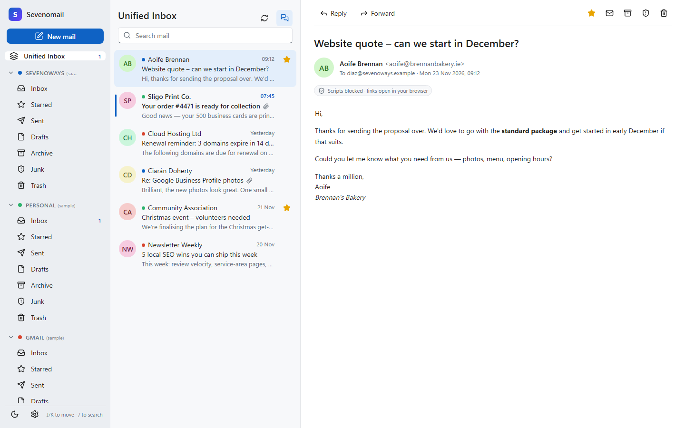

  

<h1 align="center">Sevenomail</h1>

  <b>A fast, private email client for Windows.</b> 
  All your accounts in one calm, clean inbox, by <a href="https://sevenoways.com">Sevenoways</a>.

  <a href="https://github.com/sevenoways/sevenomail-releases/releases/latest"><b>⬇ Download for Windows</b></a>
  &nbsp;·&nbsp;
  <a href="https://sevenomail.com">sevenomail.com</a>

---

## Why Sevenomail

- **Every account, one inbox.** Add your work, personal and Gmail accounts and read them together in the Unified Inbox, or one at a time. Replies go out from the address the mail came to.
- **Private by design.** Emails can't run scripts, and images from the internet stay blocked until you choose to load them, so senders can't see when you open their mail. Passwords are kept in Windows Credential Manager, never in a file. There's no Sevenomail account and no tracking: your mail goes straight between your PC and your mail server.
- **Fast, and it works offline.** New mail arrives in seconds (IMAP push), and the mail you've downloaded stays readable without a connection.
- **Set up in seconds.** Type your email address and password; Sevenomail finds the server settings itself.
- **Feels at home on Windows 11.** Light and dark themes, notifications you can click to open the message, a tray icon, start with Windows, and keyboard shortcuts.

## Features

| | |
|---|---|
| **Accounts** | Multiple accounts, Unified Inbox, colour per account, signature per account |
| **Mail** | IMAP (with push) and POP3, conversations, search, star, archive, Junk, custom folders |
| **Writing** | Reply, forward, attachments (button or drag and drop), choose which account to send from |
| **Reading** | Attachments open or save, links open in your browser, "Load images" per message or sender |
| **Sync** | Choose how far back, how many messages, how often, and which folders |
| **Updates** | Sevenomail tells you when a new version is ready and updates in one click. It never installs anything without asking. |

**Works with:** Gmail (with an app password), Purelymail, FranklyMail, and any mail provider or web host that offers IMAP or POP3 over SSL/TLS.

## Install

1. Download **`Sevenomail_x.y.z_x64-setup.exe`** from the [latest release](https://github.com/sevenoways/sevenomail-releases/releases/latest).
2. Run it. Windows may show **"Windows protected your PC"** because Sevenomail is new: choose **More info → Run anyway**.
3. Open Sevenomail and click **Add account**.

Needs Windows 10 or 11 (64-bit). Later versions arrive through the app's own update button.

## Questions and feedback

Found a problem or have an idea? [Open an issue](https://github.com/sevenoways/sevenomail-releases/issues) or visit [sevenomail.com](https://sevenomail.com).

---

This repository holds Sevenomail's installers and update files. Every update is signed, and Sevenomail checks the signature before installing it. © Sevenoways.
